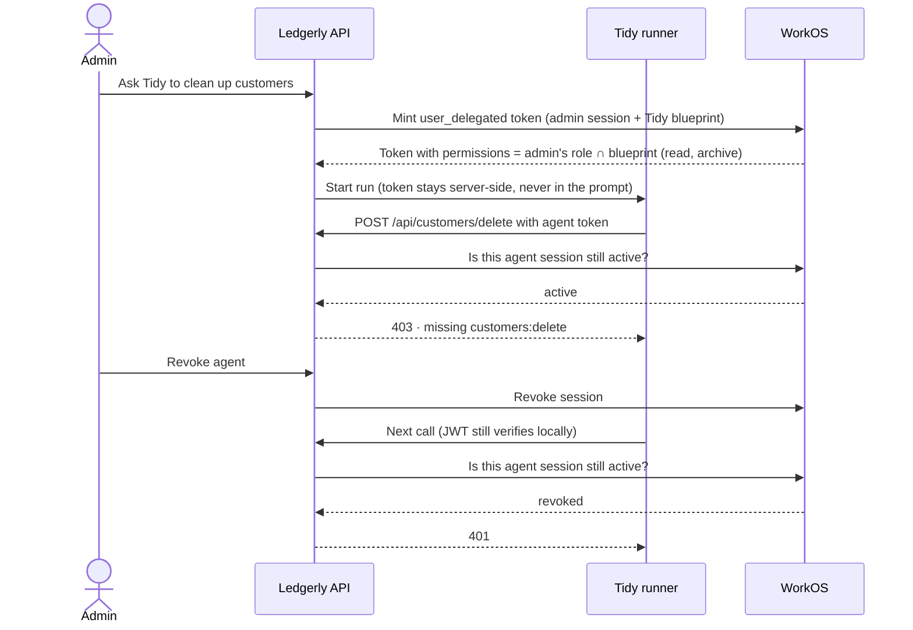

# Tidy: an in-app agent you can scope and revoke

An example Next.js app showing how to give an AI assistant inside a B2B product its own scoped, revocable identity with [WorkOS Agent Auth](https://workos.com/docs/authkit/agent-blueprints). It's for developers who need to tell their customers exactly what the agent can do, who it acts for, and how to stop it.

## What it demonstrates

Ledgerly is a fictional SaaS product. You sign in as the admin of the **Acme Corp** workspace (role `data-manager`: read, archive and delete customers). Tidy, the built-in assistant, is capped at **read + archive** by its agent blueprint.

1. **Ask Tidy** to "Clean up customers inactive for 2+ years." Ledgerly mints a `user_delegated` agent token from your session. The identity card shows its claims: `sub`, `act.sub` (you), `org_id`, `permissions`, `exp`.
2. **Watch it get refused.** Tidy finds 402 stale customers, tries to delete one, and gets **403 · missing customers:delete**. It stops and offers to archive instead.
3. **Delete a row yourself:** 200. Same API, different identity.
4. **Revoke the agent.** The JWT still verifies locally, WorkOS reports the session revoked, and Ledgerly's API returns 401 on the agent's next call.

## Prerequisites

- Node.js 24 or later, with pnpm 11 (via Corepack).
- A WorkOS staging environment with **Agent Auth** enabled (currently early access). A new, empty environment works.
- A Google account to sign in with.
- Optional: a [Gemini API key](https://aistudio.google.com/apikey) (`GEMINI_API_KEY` in `.env.local`). Without one, the assistant runs a scripted, non-LLM version of the same calls and says so in the panel.

## Setup

### 1. Install

```sh
nvm use                          # Node 24 (.nvmrc)
corepack enable                  # on Node 25+, run `npm install -g corepack` first
pnpm install --frozen-lockfile
```

### 2. Connect your WorkOS environment

```sh
cp .env.example .env.local       # fill in WORKOS_API_KEY and WORKOS_CLIENT_ID from the dashboard
```

These settings have no API, so set them in the WorkOS dashboard:

- **Authentication:** make Google OAuth the only sign-in method (staging demo credentials work).
- **Redirects:** sign-out `http://localhost:3000` and initiate login `http://localhost:3000/login`.

### 3. Set up WorkOS resources

**Quick setup (recommended):**

```sh
pnpm setup:workos --email you@example.com
```

This creates the permissions, `data-manager` role, Acme Corp organization (or reuses the one in `.env.local`), callback redirect and Tidy blueprint, and writes the remaining values to `.env.local`. It also invites your email with the `data-manager` role and prints the invitation link (also emailed). Accept it with Google. Safe to re-run.

<details>
<summary><strong>Or set up by hand in the dashboard</strong></summary>

1. Create permissions `customers:read`, `customers:archive` and `customers:delete`, and a role `data-manager` with all three.
2. Create an organization and give your user the `data-manager` role in it.
3. Under Redirects, add the callback `http://localhost:3000/callback`.
4. Fill in `.env.local`:

   | Variable | Value |
   | --- | --- |
   | `WORKOS_COOKIE_PASSWORD` | A random string of at least 32 characters, e.g. `openssl rand -base64 24` |
   | `NEXT_PUBLIC_WORKOS_REDIRECT_URI` | `http://localhost:3000/callback` |
   | `WORKOS_ORGANIZATION_ID` | The organization from step 2 |
   | `WORKOS_AGENT_ISSUER` | The `issuer` from `https://<your-authkit-domain>/.well-known/openid-configuration` |

5. Create the agent blueprint, then add the `WORKOS_AGENT_BLUEPRINT_ID` it prints to `.env.local`:

   ```sh
   node --env-file=.env.local scripts/setup-blueprint.ts
   ```

</details>

After changing Tidy's permissions in `demo.config.ts` or token lifetimes in `config/tidy.ts`, re-run `pnpm setup:workos` (or the blueprint script).

### 4. Run

```sh
pnpm dev
```

Open http://localhost:3000 and sign in with Google. "Sign-in could not finish" means the account isn't in the organization with the `data-manager` role. Right after accepting the invitation, try once more.

## How it works

- **The blueprint's permissions are a ceiling on what the agent can do.** When minting, WorkOS sets the token's `permissions` to the overlap of your role's permissions and the blueprint's. The system prompt tells the model it may delete; the token has no `customers:delete`, so the API refuses anyway.
- **Every request checks that the agent's session is live.** A valid signature only proves the token was issued. Before any customer access, the API asks WorkOS whether the session is still active, so a revoke takes effect on the agent's next call. If WorkOS can't be reached, access is denied.



| File | Role |
| --- | --- |
| `lib/require-permission.ts` | The guard on every customer route. A `Bearer` header is always treated as an agent token and never falls back to the browser session. |
| `lib/agent-auth.ts` | Mints and revokes agent tokens, verifies the JWT (signature, issuer, audience, blueprint, org, `act`), and checks the session is live. |
| `lib/gemini-agent.ts`, `lib/scripted-agent.ts` | The two assistant runners. Both call the API over HTTP with the agent token; the model never sees it. |
| `app/api/agent/run/route.ts` | Streams the assistant's tool calls to the side panel. |
| `app/actions/demo.ts` | Starts, inspects and revokes the agent session on the admin's behalf. |
| `app/login/route.ts`, `app/callback/route.ts` | Human sign-in with AuthKit. |
| `demo.config.ts` | Product names, prompts, permission slugs and the agent ceiling. |
| `scripts/setup-workos.ts` | The quick setup: creates the WorkOS resources through the API and writes `.env.local`. |

## Development

```sh
pnpm test && pnpm typecheck && pnpm lint && pnpm build
```

## Limitations

- Customers, agent sessions and activity are kept in memory. Restarting the server resets them, and the app must run as a single process.
- Assistant runs time out after two minutes.
- It only covers agents acting for a signed-in user (`user_delegated`). Autonomous agents, and third-party agents connecting from outside your product, are out of scope.
- Sign-in is Google only. To add a provider, enable it in the dashboard and add it to `allowedMethods` in `app/callback/route.ts`.
